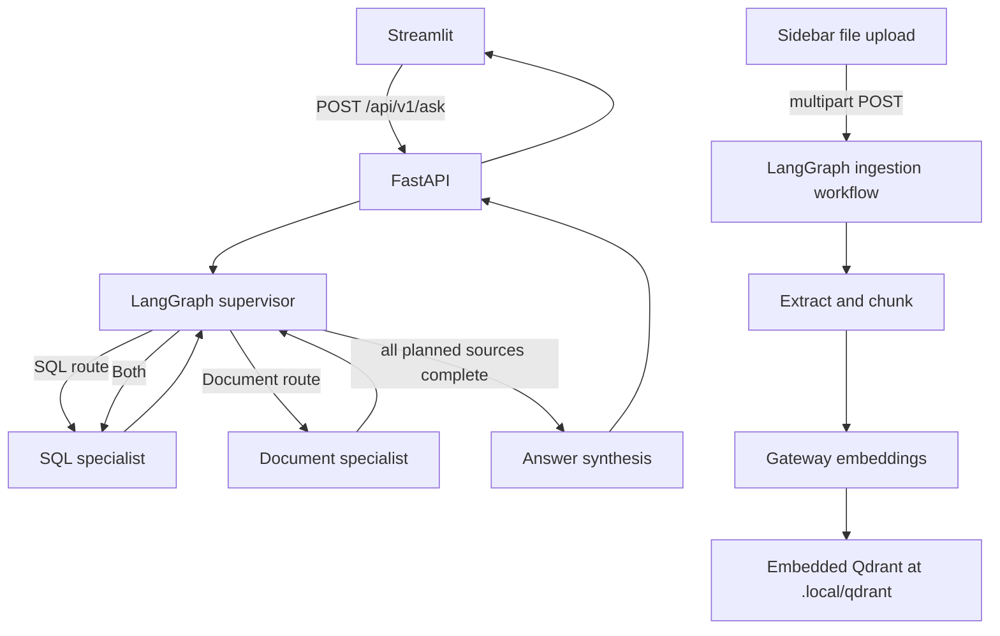

# RetailIQ Data And Policy Assistant

A FastAPI and Streamlit application that uses a LangGraph supervisor to answer retail questions from MySQL, uploaded documents, or both. Local document vectors are stored in embedded Qdrant; no Qdrant server or Docker is needed for local development.

## What Runs



### Question Flow

1. Streamlit sends the user’s question to `POST /api/v1/ask`. FastAPI validates it, assigns a request ID, and logs the request.
2. The LangGraph supervisor asks the configured LLM to interpret the complete question and return one or both sources with a focused sub-query. There is no keyword-based hardcoded router.
3. The SQL specialist asks the LLM to generate one MySQL `SELECT` using `database/schema_reference.md`, validates it with the read-only SQL guard, executes it, and returns the query and result rows.
4. The document specialist embeds its sub-query, searches Qdrant within the tenant/user scope, and returns source-tagged document chunks.
5. Each specialist marks its route complete and returns control to the supervisor. Once the plan is complete, the final node synthesizes an answer from the gathered evidence.
6. The API returns the answer and evidence. The UI shows SQL and rows for SQL evidence, and citations/chunks for document evidence.

The graph and state are in `src/agents/graph.py` and `src/agents/state.py`. Specialist and route decisions are in `src/agents/specialists.py` and `src/agents/supervisor.py`. Database/document tools are in `src/tools/`; persistence and ingestion are in `src/services/`; HTTP routes are in `src/api/`.

### Conversation Memory

The agent retains the latest five completed turns per conversation: each question, answer, and a bounded evidence snapshot. The supervisor uses this context to resolve follow-ups, answering from prior evidence when it is sufficient or routing to SQL/documents when new information is needed. Checkpoints are stored locally in `.local/agent_memory.sqlite`, scoped by tenant, user, and conversation ID. The Streamlit “Clear conversation” action deletes that thread’s checkpoint and starts a new conversation. The database is ignored by Git; deleting it erases all saved conversation memory.

### Document Upload Flow

The Streamlit sidebar uploader accepts PDF, DOCX, TXT, Markdown, and CSV files up to 15 MiB. The upload calls `POST /api/v1/documents/upload`, which runs the uploaded bytes through the LangGraph ingestion workflow. The workflow extracts text, splits it into chunks, generates embeddings through the configured Tiger AI Gateway, and stores vectors and ownership metadata in Qdrant.

The separate `POST /api/v1/ingestion/reindex` endpoint indexes files already present in `data/documents`. To add a file interactively, use the Streamlit uploader; reindex does not upload files.

## Local Qdrant: No Docker Required

For development, set `APP_ENV=development`, leave `QDRANT_URL` empty, and the application uses the Qdrant client’s embedded persistent mode. The database files live under `.local/qdrant`, which is ignored by Git and retained between restarts. The client and collection are created on first use. There is no Docker service to install or start.

If a development `.env` points `QDRANT_URL` at an unavailable localhost server, the application falls back to the embedded store. A configured remote URL uses that remote Qdrant service. Production mode requires `QDRANT_URL`; it does not silently fall back to a local store.

Qdrant stores document vectors, not the source-of-truth original uploaded files. Keep the original files separately if archival/download is required.

## Clean Setup (Windows PowerShell)

Python 3.10 or newer and MySQL Server are required. No Docker installation is
needed for Qdrant. Run from the repository root:

```powershell
cd "C:\GenAI Projects\SQL Agent"
py -3 -m venv .venv
.\.venv\Scripts\Activate.ps1
python -m pip install --upgrade pip
pip install -r requirements.txt
```

The single `requirements.txt` includes application, test, workbook, and Ragas
evaluation dependencies. DeepEval is not used by the current codebase and is
not installed.

For a clean reset of Python test caches, stop the API/UI first, remove
`.pytest_cache` and all `__pycache__` directories, then rerun the
commands above. Do not remove `.local/qdrant` unless you intentionally want to
erase all locally indexed document vectors. It is application data, not a
cache.

## Configure Services

Copy `.env.example` to `.env`, then set your MySQL and Tiger AI Gateway credentials. For local Qdrant use these settings:

```env
APP_ENV=development
QDRANT_URL=
QDRANT_API_KEY=
QDRANT_COLLECTION=retailiq_documents
QDRANT_VECTOR_SIZE=1536
QDRANT_LOCAL_PATH=.local/qdrant
```

`AI_GATEWAY_URL`, `AI_GATEWAY_API_KEY`, and `AI_GATEWAY_MODEL` configure chat
completions and embeddings. The vector size must match the embedding model
dimension. MySQL Server must be running with the configured database and
credentials. Qdrant requires no separate setup in development.

## Prepare MySQL And Documents

Create/load the MySQL schema and CSV data after configuring the MySQL fields in `.env`:

```powershell
python .\database\load_data.py
```

There are two ways to index the bundled `data/documents` files:

- Upload additional files from the Streamlit sidebar; upload immediately extracts, embeds, and indexes them.
- Index or refresh files already in `data/documents` by running `python .\src\ingest.py` or explicitly calling `POST /api/v1/ingestion/reindex`.

Both ingestion paths require the configured AI gateway embedding endpoint. Local
Qdrant data is created automatically under `.local/qdrant`.

The reindex endpoint is not called by the chat UI and does not run for each
question. It only indexes files already on disk in `data/documents`. Call it
after adding/changing those files:

```powershell
Invoke-RestMethod -Uri http://127.0.0.1:8000/api/v1/ingestion/reindex -Method Post
```

Files uploaded through the UI are indexed immediately through the same
LangGraph ingestion workflow.

## Run And Verify

Start the API in the first PowerShell terminal. Keep it open to see structured JSON logs and request IDs:

```powershell
cd "C:\GenAI Projects\SQL Agent"
.\.venv\Scripts\Activate.ps1
uvicorn src.api.main:app --reload --host 127.0.0.1 --port 8000 --log-level info
```

In a second terminal, verify the API and open its interactive docs:

```powershell
Invoke-RestMethod http://127.0.0.1:8000/health
Start-Process http://127.0.0.1:8000/docs
Invoke-WebRequest http://127.0.0.1:8000/metrics | Select-String "retailiq_"
```

`/health` checks only that FastAPI is responding. A successful SQL question additionally requires MySQL; a document question requires the LLM embedding endpoint and embedded/remote Qdrant.

Test a request directly:

```powershell
$body = @{ question = "Show top 5 product categories by revenue" } | ConvertTo-Json
Invoke-RestMethod -Uri http://127.0.0.1:8000/api/v1/ask -Method Post -ContentType "application/json" -Body $body
```

Start the UI in a third terminal:

```powershell
cd "C:\GenAI Projects\SQL Agent"
.\.venv\Scripts\Activate.ps1
streamlit run .\src\streamlit_app.py
```

Open the URL printed by Streamlit (normally `http://localhost:8501`). Use the sidebar to upload a policy/reference file, or ask a question in the chat input. FastAPI must remain running while using the UI.

To inspect an API failure, use the request ID displayed in the UI/API response and find the matching `request_id` in the backend terminal logs.

## Export The Graph Diagram

The Mermaid source can be saved locally without a renderer service:

```powershell
python -c "from src.agents.graph import save_graph_mermaid_source; print(save_graph_mermaid_source())"
```

To create a PNG image using LangGraph’s Mermaid renderer:

```powershell
python -c "from src.agents.graph import save_graph_mermaid_image; print(save_graph_mermaid_image())"
```

The PNG helper uses LangGraph’s default Mermaid API renderer, so it needs network access to that renderer. Both outputs default to `evidence/`, which is generated output and ignored by Git. You can pass a `Path` argument to either function to select another output path.

## Tests

Run the offline/unit suite without creating Python or pytest cache files:

```powershell
$env:PYTHONDONTWRITEBYTECODE = "1"
python -m pytest -q -p no:cacheprovider
```

The evaluation preflight checks the edited workbook's required columns,
expected route labels, and expected document sources without calling external
services. Run it using:

```powershell
python -m pytest -q -p no:cacheprovider evaluations/test_evaluations.py -k "not agent_against_workbook_ground_truth"
```

The live evaluation runs cases in worksheet order through the supervisor,
LLM, MySQL, and Qdrant. One fresh conversation is used for the run because
cases such as TC-005/TC-006 and TC-010 are follow-ups. `chosen routes` and
`Chosen docs` are the expected route and source labels. The evaluator reports
route-set match/precision/recall/F1, whether SQL is safe and executable, Ragas
document context precision/recall, Ragas final-answer faithfulness/relevancy,
and records generated answers, SQL, and retrieved sources for inspection. It
does not compare SQL text or database result-column names to gold values.

Ensure the dependencies from `requirements.txt` are installed and configure/load
MySQL and documents before running the live evaluation:

```powershell
$env:RUN_AGENT_EVALUATIONS = "1"
$env:PYTEST_DISABLE_PLUGIN_AUTOLOAD = "1"
python -m pytest -q -p no:cacheprovider evaluations/test_evaluations.py
```

The report `evaluations/test_cases_evaluation_results.xlsx` is created from the
ground-truth workbook for each live run, so the source workbook remains
unchanged. Its Summary sheet reports each score and the number of cases scored.
Metrics that do not apply to a case, such as document context scores for SQL-
only cases, remain blank and are excluded from that metric's denominator.

To rescore a report that already contains generated answers and saved evidence,
use the Ragas-only refresh. This does not call the supervisor, MySQL, or Qdrant.
Try one document case first, then score the remaining cases that still have
missing Ragas metrics:

```powershell
python -m evaluations.refresh_ragas_metrics --test-id TC-012
python -m evaluations.refresh_ragas_metrics --skip-scored
```

Close the report workbook in Excel before refreshing it. `--skip-scored` leaves
completed Ragas scores alone and fills only missing applicable metrics.

The live evaluation makes model and judge requests and may incur gateway costs.
Review each case's `Evaluation Error` and the Summary before interpreting the
scores; evaluation metrics are signals, not guarantees.

## Evaluation & Benchmark Results

The evaluation framework exercises the LangGraph multi-agent architecture,
Qdrant vector retrieval, and Ragas metrics for answer faithfulness, answer
relevancy, context precision, and context recall. SQL safety is checked by a
read-only `SELECT` validator with blocked-keyword and multi-statement checks.
Despite sometimes being described as AST guardrails, the current implementation
uses lexical checks rather than parsing SQL into an AST.

The benchmark contains 30 end-to-end cases spanning pure SQL, document RAG,
hybrid questions, conversational state/memory, and adversarial destructive
queries. The recorded benchmark results are:

| Metric | Result |
|---|---:|
| Routing accuracy | 93.3% (28/30) |
| SQL safety pass rate | 100% (17/17 applicable cases) |
| Answer faithfulness | 86.1% |
| Context recall | 75.4% |

The routing and SQL safety figures match the current report workbook. The
Ragas figures above are the reported benchmark results, but are not currently
reproducible from `evaluations/test_cases_evaluation_results.xlsx`: its
faithfulness column has only one populated case, and its context-recall column
has none. Refresh the Ragas scores before treating those two figures as
independently verified by the workbook.

To reproduce the evaluation, run these commands from the repository root in
PowerShell. The first command runs workbook preflight and offline evaluator
tests without running the live end-to-end benchmark:

```powershell
python -m pytest -q -p no:cacheprovider evaluations/test_evaluations.py -k "not agent_against_workbook_ground_truth"
```

For the full 30-case benchmark, ensure MySQL and the required document/vector
data are ready, and enable the live evaluation:

```powershell
$env:RUN_AGENT_EVALUATIONS = "1"
$env:PYTEST_DISABLE_PLUGIN_AUTOLOAD = "1"
python -m pytest -q -p no:cacheprovider evaluations/test_evaluations.py
```

To rescore saved answers and evidence without rerunning the supervisor,
database, or Qdrant retrieval, use the Ragas refresh script:

```powershell
python -m evaluations.refresh_ragas_metrics --report evaluations\test_cases_evaluation_results.xlsx --skip-scored
```

The refresh still contacts the configured LLM and embedding services for Ragas
judgments and can incur gateway costs. Close the workbook in Excel first; if
it is locked, the refresh saves a separate `_ragas_refreshed` workbook.

## Repository Map

- `data/`: retail CSV source data and bundled policy/FAQ documents.
- `database/`: MySQL schema, schema reference, and CSV loader.
- `src/api/`: FastAPI app and chat/document/health routes.
- `src/agents/`: LangGraph graph, typed state, supervisor, and SQL/document specialists.
- `src/clients/`: Tiger AI Gateway client.
- `src/config/`: environment-backed settings.
- `src/models/`: supervisor and document schemas.
- `src/observability/`: request logging and Prometheus metrics.
- `src/services/`: embedding/document ingestion and Qdrant operations.
- `src/tools/`: read-only SQL, SQL validation, and document retrieval tools.
- `src/ui/`: Streamlit experience; `src/streamlit_app.py` is its launch wrapper.
- `src/workflows/`: LangGraph ingestion workflow.
- `tests/`: route, API, ingestion, Qdrant, and SQL safety tests.
- `evaluations/`: the ground-truth workbook, focused evaluator, and generated
    evaluation report.
- `.local/qdrant/`: persistent local vector database, generated automatically and ignored by Git.
